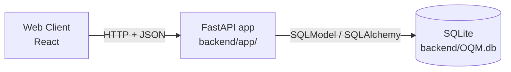
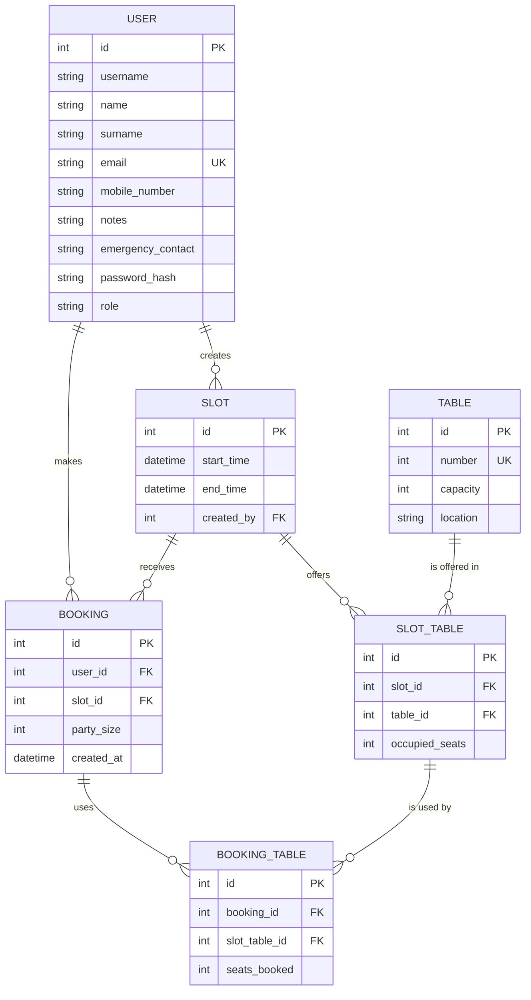

# Mountain Hut

> A software system supporting the activities of a mountain hut.

## Contents

- [Overview](#overview)
- [The problem](#the-problem)
- [Purpose](#purpose)
- [Roles](#roles)
- [Development](#development)
  - [Architecture](#architecture)
  - [Tech stack](#tech-stack)
  - [Backend structure](#backend-structure)
  - [Database](#database): [`user`](#user), [`table`](#table), [`slot`](#slot), [`slot_table`](#slot_table), [`booking`](#booking), [`booking_table`](#booking_table)
- [Backend EndPoint](#backend-endpoint)
  - [Routes](#routes): [`GET /slot`](#get-slot), [`GET /slot/{id}`](#get-slotid)
  - [Objects](#objects): [`Slot`](#slot-object), [`SlotDetail`](#slotdetail-object), [`SlotTableInfo`](#slottableinfo-object)
  - [Errors](#errors)

## Overview

**Mountain Hut** is a web-based system that supports the day-to-day operations of an alpine mountain hut. These huts are simple hospitality facilities that offer shared sleeping spaces, communal dining, basic food and shelter. Hikers use them as day-trip destinations, overnight stops on longer routes, or bases for further hikes. They are often owned by alpine clubs or public bodies and run by a warden with a small staff.

## The problem

Huts work under tight constraints:

- **Limited resources**: space, supplies and energy restrict what the hut can offer, and staff must split their time between serving guests and preparing for later arrivals.
- **Changing demand**: weather and mountain conditions change visitors' plans, and meal times can bring many arrivals at once.
- **Scattered information**: requests come in through web, phone, messages and in person. When those records are scattered, staff can miss changes, misread a party's needs, or commit to more than the hut can handle.

## Purpose

The system gives hikers and the hut team one shared, up-to-date source of information:

- **For visitors**: more confidence when planning their stop and adapting their journey.
- **For hut staff**: better use of limited resources and fewer misunderstandings when plans change.

## Roles

| Role         | Description                                                           |
|--------------|-----------------------------------------------------------------------|
| **User**     | Anyone accessing the public web pages.                                |
| **Hiker**    | A registered visitor, acting alone or as the contact person for a party. |
| **Warden**   | Manages the hut and makes operational decisions. Can also act as an employee. |
| **Employee** | Handles the hut's daily operations.                                   |

Inside the project there are some seed data including some users:

|role|email|pwd|
|----|----|----|
|warden|luca.bonetti@rifugio.example|warden|
|Employee|giulia.ferrero@rifugio.example|employee|
|Hiker|anna.rossi@mail.example|hiker|
|Hiker|paolo.bianchi@mail.example|hiker|

## Development

The project is developed with **Scrum** in two-week sprints.


### Architecture



- **FastAPI** exposes the REST endpoints and validates requests and responses.
- **SQLModel** defines each table once. The same class is used as the database table and as the Pydantic model for request and response bodies.
- **SQLite** stores the data in a single file, `backend/OQM.db`, so no database server is needed.

### Tech stack

| Component         | Library                      | Version             |
| ----------------- | ---------------------------- | ------------------- |
| Fronted Framework | React                        |                 |
| API framework     | FastAPI                      | 0.142.2             |
| ORM / models      | SQLModel (on SQLAlchemy 2.1) | 0.0.48              |
| Database          | SQLite                       | bundled with Python |
| Tests             | pytest + `unittest.mock`     | pytest 9.1.1        |

The requirements of the backend can be found in the [requirements.txt](../backend/requirements.txt) in the backend folder. To install and it is suggested to check the appropriate document in that folder with all the instructions.

### Backend structure

The backend code is in the [`backend/app/`](../backend/app/) package:

```
app/
├── main.py              # creates the app, startup logic (lifespan), mounts the routers
├── config.py            # settings read from environment variables (DATABASE_URL)
├── database.py          # engine, get_session / SessionDep dependency
├── models/              # SQLModel tables and request bodies
│   #all the models here
├── routers/             # HTTP endpoints, one APIRouter per resource
│   # all the routers
└── services/            # logic shared by the routes
  
```

### Database

This schema defines the overall structure of the project until user-story: #4; Other user-story may change database representation.



Columns are `NOT NULL` unless marked as nullable.

#### `user`

A person with an account in the system.

| Column              | Type    | Constraints | Description                               |
|---------------------|---------|-------------|-------------------------------------------|
| `id`                | INTEGER | PK          | User identifier                           |
| `username`          | VARCHAR |             | Username                                  |
| `name`              | VARCHAR |             | First name                                |
| `surname`           | VARCHAR |             | Last name                                 |
| `email`             | VARCHAR | UNIQUE      | Email address                             |
| `mobile_number`     | VARCHAR | nullable    | Mobile number                             |
| `notes`             | VARCHAR | nullable    | Free notes                                |
| `emergency_contact` | VARCHAR | nullable    | Emergency contact                         |
| `password_hash`     | VARCHAR |             | Password hash                             |
| `role`              | VARCHAR |             | `Hiker`, `Warden` or `Employee`           |

#### `table`

A physical table of the hut.

| Column     | Type    | Constraints | Description          |
|------------|---------|-------------|----------------------|
| `id`       | INTEGER | PK          | Table identifier     |
| `number`   | INTEGER | UNIQUE      | Number of the table  |
| `capacity` | INTEGER |             | Total seats          |
| `location` | VARCHAR |             | Where the table is   |

#### `slot`

A time window that can be booked.

| Column       | Type     | Constraints    | Description               |
|--------------|----------|----------------|---------------------------|
| `id`         | INTEGER  | PK             | Slot identifier           |
| `start_time` | DATETIME |                | Start of the slot         |
| `end_time`   | DATETIME |                | End of the slot           |
| `created_by` | INTEGER  | FK → [`user.id`](#user) | User who defined the slot |

#### `slot_table`

A table available in a slot. A slot offers one or more tables.

| Column           | Type    | Constraints     | Description                    |
|------------------|---------|-----------------|--------------------------------|
| `id`             | INTEGER | PK              | Identifier a booking refers to |
| `slot_id`        | INTEGER | FK → [`slot.id`](#slot)  | The slot                       |
| `table_id`       | INTEGER | FK → [`table.id`](#table) | The table offered              |
| `occupied_seats` | INTEGER | CHECK `>= 0`    | Seats already taken            |

Each table appears at most once per slot: `UNIQUE (slot_id, table_id)`.
The `occupied_seats` is redundant on porpuse to not recaulcate it every time from the bookings table.
#### `booking`

A reservation made by a user for a slot.

| Column       | Type     | Constraints    | Description               |
|--------------|----------|----------------|---------------------------|
| `id`         | INTEGER  | PK             | Booking identifier        |
| `user_id`    | INTEGER  | FK → [`user.id`](#user) | User who made the booking |
| `slot_id`    | INTEGER  | FK → [`slot.id`](#slot) | The booked slot           |
| `party_size` | INTEGER  |                | Number of people          |
| `created_at` | DATETIME |                | Creation time             |

#### `booking_table`

The seats a booking uses on one of the tables of its slot. A booking uses one or more of them.

| Column          | Type    | Constraints          | Description              |
|-----------------|---------|----------------------|--------------------------|
| `id`            | INTEGER | PK                   | Identifier               |
| `booking_id`    | INTEGER | FK → [`booking.id`](#booking)    | The booking              |
| `slot_table_id` | INTEGER | FK → [`slot_table.id`](#slot_table) | The table in the slot    |
| `seats_booked`  | INTEGER |                      | Seats used on that table |

Each slot table appears at most once per booking: `UNIQUE (booking_id, slot_table_id)`.


## Backend EndPoint
The full OpenAPI documentation can be found on the backend URL at [`/docs`](http://127.0.0.1:8000/docs), which is autogenerated by the FastAPI framework. The links to `127.0.0.1:8000` work while the backend is running locally.

### Routes

Here is a quick overview of the routes, defined in [`routers/slot.py`](../backend/app/routers/slot.py):

| Method | Route                       | Login required | Input                  | Success                                         | Errors                  |
|--------|-----------------------------|----------------|------------------------|-------------------------------------------------|-------------------------|
| GET    | [`/slot`](#get-slot)        | No             | -                      | `200` list of [`Slot`](#slot-object)            | -                       |
| GET    | [`/slot/{id}`](#get-slotid) | No             | `id` in the path (int) | `200` [`SlotDetail`](#slotdetail-object)        | [`404`, `422`](#errors) |

#### `GET /slot`

Returns all the slots as a list of [`Slot`](#slot-object).

Try it: <http://127.0.0.1:8000/slot>

#### `GET /slot/{id}`

Returns one slot as a [`SlotDetail`](#slotdetail-object), with all the tables it offers. It can fail with a [`404` or a `422`](#errors).

Try it: <http://127.0.0.1:8000/slot/1>

### Objects

The objects returned by the routes, defined in [`models/slot.py`](../backend/app/models/slot.py):

| Object                                     | Returned by                                  | Built from                                    |
|--------------------------------------------|----------------------------------------------|-----------------------------------------------|
| [`Slot`](#slot-object)                     | [`GET /slot`](#get-slot)                     | [`slot`](#slot)                               |
| [`SlotDetail`](#slotdetail-object)         | [`GET /slot/{id}`](#get-slotid)              | [`slot`](#slot)                               |
| [`SlotTableInfo`](#slottableinfo-object)   | Inside [`SlotDetail`](#slotdetail-object)    | [`slot_table`](#slot_table), [`table`](#table) |

#### `Slot` object

| Field        | Type     | Description                                 |
|--------------|----------|---------------------------------------------|
| `id`         | int      | Slot identifier                             |
| `start_time` | datetime | Start of the slot                           |
| `end_time`   | datetime | End of the slot                             |
| `created_by` | int      | Id of the [`user`](#user) who defined the slot |

```json
{
  "id": 1,
  "start_time": "2026-10-31T11:00:00",
  "end_time": "2026-10-31T12:30:00",
  "created_by": 1
}
```

#### `SlotDetail` object

| Field        | Type                                              | Description                                 |
|--------------|---------------------------------------------------|---------------------------------------------|
| `id`         | int                                               | Slot identifier                             |
| `start_time` | datetime                                          | Start of the slot                           |
| `end_time`   | datetime                                          | End of the slot                             |
| `created_by` | int                                               | Id of the [`user`](#user) who defined the slot |
| `tables`     | list of [`SlotTableInfo`](#slottableinfo-object)  | The tables offered in the slot              |

```json
{
  "id": 1,
  "start_time": "2026-10-31T11:00:00",
  "end_time": "2026-10-31T12:30:00",
  "created_by": 1,
  "tables": [
    { "id": 1, "table_id": 1, "seats_booked": 4, "seats_free": 0 },
    { "id": 2, "table_id": 2, "seats_booked": 0, "seats_free": 4 }
  ]
}
```

#### `SlotTableInfo` object

One table offered in the slot, with how many of its seats are still free.

| Field          | Type | Description                                                  |
|----------------|------|--------------------------------------------------------------|
| `id`           | int  | Id of the [`slot_table`](#slot_table) row                    |
| `table_id`     | int  | Id of the [`table`](#table) offered                          |
| `seats_booked` | int  | Seats already taken (`occupied_seats`)                       |
| `seats_free`   | int  | Seats still available (`capacity - occupied_seats`)          |

### Errors

| Code  | Route                       | Message             | When                   |
|-------|-----------------------------|---------------------|------------------------|
| `404` | [`/slot/{id}`](#get-slotid) | `Slot not found`    | No slot with that id   |
| `422` | [`/slot/{id}`](#get-slotid) | Automatic (FastAPI) | `id` is not an integer |

The `404` is returned as `{ "detail": "<message>" }`; for the `422`, `detail` is the list of the invalid fields.

[Back to top](#mountain-hut)

