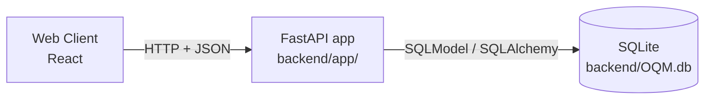
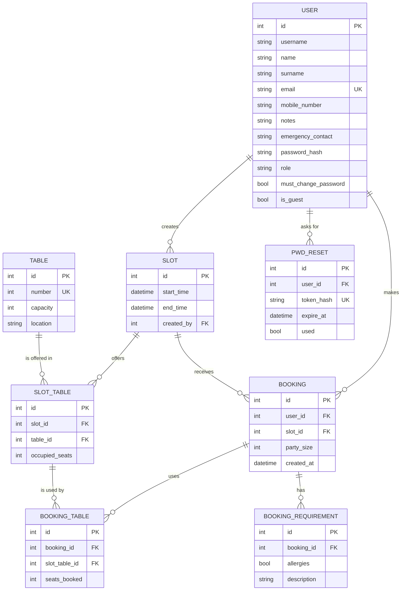

# Mountain Hut

> A software system supporting the activities of a mountain hut.

## Contents

- [Overview](#overview)
- [The problem](#the-problem)
- [Purpose](#purpose)
- [Roles](#roles)
- [Development](#development)
  - [Architecture](#architecture)
  - [Tech stack](#tech-stack)
  - [Backend structure](#backend-structure)
  - [Database](#database): [`user`](#user), [`table`](#table), [`slot`](#slot), [`slot_table`](#slot_table), [`booking`](#booking), [`booking_table`](#booking_table), [`booking_requirement`](#booking_requirement), [`pwd_reset`](#pwd_reset)
- [Backend EndPoint](#backend-endpoint)
  - [Authentication](#authentication)
  - [Routes](#routes): [`GET /slot`](#get-slot), [`GET /slot/{id}`](#get-slotid), [`GET /availability`](#get-availability), [`POST /booking`](#post-booking), [`GET /booking`](#get-booking), [`PATCH /booking/{booking_id}`](#patch-bookingbooking_id), [`DELETE /booking/{booking_id}`](#delete-bookingbooking_id), [`POST /booking/hiker/{hiker_id}`](#post-bookinghikerhiker_id), [`POST /register`](#post-register), [`POST /login`](#post-login), [`POST /token`](#post-token), [`POST /logout`](#post-logout), [`GET /users/me`](#get-usersme), [`POST /auth/forgot-password`](#post-authforgot-password), [`POST /auth/reset-password`](#post-authreset-password), [`POST /auth/change-password`](#post-authchange-password), [`GET /profileCheck`](#get-profilecheck), [`POST /registerHiker`](#post-registerhiker), [`POST /registerGuest`](#post-registerguest), [`DELETE /guests/{guest_id}`](#delete-guestsguest_id), [`GET /tables`](#get-tables), [`POST /tables`](#post-tables), [`GET /slots`](#get-slots), [`GET /slots/{id}`](#get-slotsid), [`POST /slots`](#post-slots), [`POST /slots/{id}/tables`](#post-slotsidtables), [`POST /slots/{id}/copy`](#post-slotsidcopy), [`POST /slots/week/copy`](#post-slotsweekcopy)
  - [Objects](#objects): [`Table`](#table-object), [`TableCreate`](#tablecreate-object), [`Slot`](#slot-object), [`SlotCreate`](#slotcreate-object), [`SlotTablesAdd`](#slottablesadd-object), [`CopySlotRequest`](#copyslotrequest-object), [`CopyWeekScheduleRequest`](#copyweekschedulerequest-object), [`SlotAvailability`](#slotavailability-object), [`SlotDetail`](#slotdetail-object), [`SlotTableInfo`](#slottableinfo-object), [`BookingCreate`](#bookingcreate-object), [`BookingRequirementCreate`](#bookingrequirementcreate-object), [`BookingUpdate`](#bookingupdate-object), [`BookingResponse`](#bookingresponse-object), [`BookingDetails`](#bookingdetails-object), [`AvailabilityResponse`](#availabilityresponse-object), [`RegisterRequest`](#registerrequest-object), [`RegisterRequestEmployee`](#registerrequestemployee-object), [`Guest`](#guest-object), [`LoginRequest`](#loginrequest-object), [`UserPublic`](#userpublic-object), [`UserBookingCreation`](#userbookingcreation-object), [`TokenResponse`](#tokenresponse-object), [`ResetPasswordRequest`](#resetpasswordrequest-object), [`ChangePasswordRequest`](#changepasswordrequest-object)
  - [Errors](#errors)

## Overview

**Mountain Hut** is a web-based system that supports the day-to-day operations of an alpine mountain hut. These huts are simple hospitality facilities that offer shared sleeping spaces, communal dining, basic food and shelter. Hikers use them as day-trip destinations, overnight stops on longer routes, or bases for further hikes. They are often owned by alpine clubs or public bodies and run by a warden with a small staff.

## The problem

Huts work under tight constraints:

- **Limited resources**: space, supplies and energy restrict what the hut can offer, and staff must split their time between serving guests and preparing for later arrivals.
- **Changing demand**: weather and mountain conditions change visitors' plans, and meal times can bring many arrivals at once.
- **Scattered information**: requests come in through web, phone, messages and in person. When those records are scattered, staff can miss changes, misread a party's needs, or commit to more than the hut can handle.

## Purpose

The system gives hikers and the hut team one shared, up-to-date source of information:

- **For visitors**: more confidence when planning their stop and adapting their journey.
- **For hut staff**: better use of limited resources and fewer misunderstandings when plans change.

## Roles

| Role         | Description                                                           |
|--------------|-----------------------------------------------------------------------|
| **User**     | Anyone accessing the public web pages.                                |
| **Hiker**    | A registered visitor, acting alone or as the contact person for a party. |
| **Warden**   | Manages the hut and makes operational decisions. Can also act as an employee. |
| **Employee** | Handles the hut's daily operations.                                   |

Inside the project there are some seed data including some users:

|role|email|pwd|
|----|----|----|
|warden|luca.bonetti@rifugio.example|warden|
|Employee|giulia.ferrero@rifugio.example|employee|
|Hiker|anna.rossi@mail.example|hiker|
|Hiker|paolo.bianchi@mail.example|hiker|

## Development

The project is developed with **Scrum** in two-week sprints.


### Architecture



- **FastAPI** exposes the REST endpoints and validates requests and responses.
- **SQLModel** defines each table once. The same class is used as the database table and as the Pydantic model for request and response bodies.
- **SQLite** stores the data in a single file, `backend/OQM.db`, so no database server is needed.

### Tech stack

| Component         | Library                      | Version             |
| ----------------- | ---------------------------- | ------------------- |
| Fronted Framework | React                        |                 |
| API framework     | FastAPI                      | 0.142.2             |
| ORM / models      | SQLModel (on SQLAlchemy 2.1) | 0.0.48              |
| Database          | SQLite                       | bundled with Python |
| Tests             | pytest + `unittest.mock`     | pytest 9.1.1        |

The requirements of the backend can be found in the [requirements.txt](../backend/requirements.txt) in the backend folder. To install and it is suggested to check the appropriate document in that folder with all the instructions.

### Backend structure

The backend code is in the [`backend/app/`](../backend/app/) package:

```
app/
├── main.py              # creates the app, startup logic (lifespan), mounts the routers
├── config.py            # settings read from environment variables (DATABASE_URL)
├── database.py          # engine, get_session / SessionDep dependency
├── models/              # SQLModel tables and request bodies
│   #all the models here
├── routers/             # HTTP endpoints, one APIRouter per resource
│   # all the routers
└── services/            # logic shared by the routes
  
```

### Database

This schema shows the database of `frontend/ui-v2`, which includes `dev`. Later user stories may change it.



Columns are `NOT NULL` unless marked as nullable.

#### `user`

A person with an account in the system, or a guest added by the staff to put in a booking.

| Column                 | Type    | Constraints        | Description                               |
|------------------------|---------|--------------------|-------------------------------------------|
| `id`                   | INTEGER | PK                 | User identifier                           |
| `username`             | VARCHAR |                    | Username                                  |
| `name`                 | VARCHAR |                    | First name                                |
| `surname`              | VARCHAR |                    | Last name                                 |
| `email`                | VARCHAR | UNIQUE, nullable   | Email address. `NULL` for a guest         |
| `mobile_number`        | VARCHAR |                    | Mobile number                             |
| `notes`                | VARCHAR | nullable           | Free notes                                |
| `emergency_contact`    | VARCHAR | nullable           | Emergency contact                         |
| `password_hash`        | VARCHAR |                    | Password hash                             |
| `role`                 | VARCHAR |                    | `Hiker`, `Warden` or `Employee`           |
| `must_change_password` | BOOLEAN | default `0`        | `1` when the password was generated by [`POST /registerHiker`](#post-registerhiker) and has not been changed yet |
| `is_guest`             | BOOLEAN | default `0`        | `1` for a guest created by [`POST /registerGuest`](#post-registerguest), who can't log in |

`must_change_password`, `is_guest` and the nullable `email` are only on `frontend/ui-v2` (see [Routes](#routes)). Older databases get them at startup: `add_user_profile_columns` adds the two columns, and `make_user_email_nullable` rebuilds the table because SQLite can't change a column. Several guests can have a `NULL` email, since the unique index only applies to real emails.

#### `table`

A physical table of the hut.

| Column     | Type    | Constraints | Description          |
|------------|---------|-------------|----------------------|
| `id`       | INTEGER | PK          | Table identifier     |
| `number`   | INTEGER | UNIQUE      | Number of the table  |
| `capacity` | INTEGER | CHECK `> 0` | Total seats          |
| `location` | VARCHAR |             | Where the table is   |

#### `slot`

A time window that can be booked.

| Column       | Type     | Constraints    | Description               |
|--------------|----------|----------------|---------------------------|
| `id`         | INTEGER  | PK             | Slot identifier           |
| `start_time` | DATETIME |                | Start of the slot         |
| `end_time`   | DATETIME |                | End of the slot           |
| `created_by` | INTEGER  | FK → [`user.id`](#user) | User who defined the slot |

#### `slot_table`

A table available in a slot. A slot offers one or more tables.

| Column           | Type    | Constraints     | Description                    |
|------------------|---------|-----------------|--------------------------------|
| `id`             | INTEGER | PK              | Identifier a booking refers to |
| `slot_id`        | INTEGER | FK → [`slot.id`](#slot)  | The slot                       |
| `table_id`       | INTEGER | FK → [`table.id`](#table) | The table offered              |
| `occupied_seats` | INTEGER | CHECK `>= 0`    | Seats already taken            |

Each table appears at most once per slot: `UNIQUE (slot_id, table_id)`.
The `occupied_seats` is redundant on porpuse to not recaulcate it every time from the bookings table.
#### `booking`

A reservation made by a user for a slot.

| Column       | Type     | Constraints    | Description               |
|--------------|----------|----------------|---------------------------|
| `id`         | INTEGER  | PK             | Booking identifier        |
| `user_id`    | INTEGER  | FK → [`user.id`](#user) | User who made the booking |
| `slot_id`    | INTEGER  | FK → [`slot.id`](#slot) | The booked slot           |
| `party_size` | INTEGER  | CHECK `> 0`    | Number of people          |
| `created_at` | DATETIME |                | Creation time             |

#### `booking_table`

The seats a booking uses on one of the tables of its slot. A booking uses one or more of them.

| Column          | Type    | Constraints          | Description              |
|-----------------|---------|----------------------|--------------------------|
| `id`            | INTEGER | PK                   | Identifier               |
| `booking_id`    | INTEGER | FK → [`booking.id`](#booking)    | The booking              |
| `slot_table_id` | INTEGER | FK → [`slot_table.id`](#slot_table) | The table in the slot    |
| `seats_booked`  | INTEGER | CHECK `> 0`          | Seats used on that table |

Each slot table appears at most once per booking: `UNIQUE (booking_id, slot_table_id)`.

#### `booking_requirement`

A need of the party of a booking, such as an allergy. A booking has zero or more of them. Defined in [`models/booking_requirement.py`](../backend/app/models/booking_requirement.py).

| Column        | Type    | Constraints                   | Description                         |
|---------------|---------|-------------------------------|-------------------------------------|
| `id`          | INTEGER | PK                            | Identifier                          |
| `booking_id`  | INTEGER | FK → [`booking.id`](#booking) | The booking                         |
| `allergies`   | BOOLEAN | default `0`                   | `1` if the need is about an allergy |
| `description` | VARCHAR | nullable                      | Free text                           |

The rows are written from the `requirements` of [`POST /booking`](#post-booking), [`POST /booking/hiker/{hiker_id}`](#post-bookinghikerhiker_id) and [`PATCH /booking/{booking_id}`](#patch-bookingbooking_id), and read by [`GET /booking`](#get-booking) and the emails. A `PATCH` that sends `requirements` deletes all the rows of the booking and writes the new ones. [`DELETE /booking/{booking_id}`](#delete-bookingbooking_id) deletes them with the booking.

#### `pwd_reset`

A password reset link sent by [`POST /auth/forgot-password`](#post-authforgot-password). Defined in [`models/user.py`](../backend/app/models/user.py).

| Column       | Type     | Constraints                 | Description                                        |
|--------------|----------|-----------------------------|----------------------------------------------------|
| `id`         | INTEGER  | PK                          | Identifier                                         |
| `user_id`    | INTEGER  | FK → [`user.id`](#user)     | The user who asked for the reset                   |
| `token_hash` | VARCHAR  | UNIQUE, indexed             | SHA-256 hash of the token in the link              |
| `expire_at`  | DATETIME |                             | When the link stops working, in UTC                |
| `used`       | BOOLEAN  | default `0`                 | `1` once the link can no longer be used            |

Only the hash of the token is saved: the token itself is only in the email, so someone reading the database can't reset a password. [`POST /auth/reset-password`](#post-authreset-password) hashes the token it receives to find the row.

A row is never deleted. `used` becomes `1` when:

- the link is used by [`POST /auth/reset-password`](#post-authreset-password). All the other pending links of the user are marked as used too.
- the user changes the password with [`POST /auth/change-password`](#post-authchange-password)

An expired row keeps `used = 0`, but it is refused because of `expire_at`. SQLite returns `expire_at` without its time zone, so the code reads it as UTC.

`booking_requirement` and `pwd_reset` are on `dev` and `frontend/ui-v2`, not on `main`. `SQLModel.metadata.create_all` creates them at startup in an existing database too.


## Backend EndPoint
The full OpenAPI documentation can be found on the backend URL at [`/docs`](http://127.0.0.1:8000/docs), which is autogenerated by the FastAPI framework. The links to `127.0.0.1:8000` work while the backend is running locally.

### Authentication

A login gives the client a signed token (JWT). The code is in [`services/auth.py`](../backend/app/services/auth.py). Each request that needs a login must carry the token in one of two ways:

| Way            | Sent as                         | Obtained from                                                                 |
|----------------|---------------------------------|-------------------------------------------------------------------------------|
| Session cookie | `session` cookie                | [`POST /login`](#post-login) or [`POST /token`](#post-token), which both set it |
| Bearer token   | `Authorization: Bearer <token>` | The `access_token` returned by [`POST /token`](#post-token)                   |

If a request carries both, only the cookie is checked. A request with an invalid cookie is refused even if its Bearer token is valid.

The cookie is HTTP-only with `SameSite=Lax`, so page scripts can't read it. It is sent only over HTTPS when `SESSION_COOKIE_SECURE=true`.

The token is signed with `SECRET_KEY` (HS256) and contains:

| Claim      | Content                                        |
|------------|------------------------------------------------|
| `sub`      | The [`user`](#user) `id`, as a string          |
| `username` | The username                                   |
| `role`     | `Hiker`, `Warden` or `Employee`                |
| `must_change_password` | `true` if the user must change the password before using the other routes (only on `frontend/ui-v2`) |
| `exp`      | Expiry, 30 minutes after the login by default (`ACCESS_TOKEN_EXPIRE_MINUTES`) |

The server keeps no list of sessions and trusts the content of a signed token until it expires. This means that:

- a token stays valid after [`POST /logout`](#post-logout), which only removes the cookie
- a token keeps the role it was created with, even if the user's role changes
- a token stays valid if its user is deleted, unless the route checks the database as [`POST /booking`](#post-booking) does

Routes limited to some roles use the `require_role` dependency, which answers `403` to any other role.

**Forced password change** (only on `frontend/ui-v2`): a hiker created by the staff with [`POST /registerHiker`](#post-registerhiker) gets a password by email and has `must_change_password` set. Until the password is changed, `require_role` answers `403 Password change required` on every route that uses it. Only the routes that don't use `require_role` still work: [`GET /users/me`](#get-usersme), [`POST /auth/change-password`](#post-authchange-password), [`POST /logout`](#post-logout) and the public routes. [`POST /auth/change-password`](#post-authchange-password) clears the flag and sets a new `session` cookie, so the user can go on without logging in again. A client that uses the Bearer token must log in again to get a token without the flag.

Passwords are stored as Argon2 hashes in `password_hash`, never in clear text.

### Routes

All the routes of the backend, defined in [`routers/slot.py`](../backend/app/routers/slot.py), [`routers/booking.py`](../backend/app/routers/booking.py), [`routers/availability.py`](../backend/app/routers/availability.py), [`routers/auth.py`](../backend/app/routers/auth.py), [`routers/tables.py`](../backend/app/routers/tables.py) and `routers/user.py`. Click a route for its details, or its errors for the list of errors it can return.

Not every branch has all the routes. The last column of the table says where each route is:

- **dev**: merged into `dev` (and so also in `frontend/ui-v2`)
- **ui-v2**: only on `frontend/ui-v2` for now, which is `dev` plus the staff booking, guest and forced password change work. `routers/user.py` exists only there, and there [`GET /users/me`](#get-usersme) moves from `routers/auth.py` to `routers/user.py`.

`main` has an older version of the backend, without the password and cancellation routes.

| Method | Route                                                     | Login required              | Input                                                                   | Success                                                                 | Errors                                                                        | Branch |
|--------|-----------------------------------------------------------|-----------------------------|-------------------------------------------------------------------------|-------------------------------------------------------------------------|-------------------------------------------------------------------------------|--------|
| GET    | [`/slot`](#get-slot)                                      | No                          | -                                                                       | `200` list of [`SlotAvailability`](#slotavailability-object)            | None                                                                          | dev    |
| GET    | [`/slot/{id}`](#get-slotid)                               | No                          | `id` in the path (int)                                                  | `200` [`SlotDetail`](#slotdetail-object)                                | [`404`, `422`](#get-slotid-errors)                                            | dev    |
| GET    | [`/availability`](#get-availability)                      | No                          | Query: `date`, `time`, `party_size`                                     | `200` [`AvailabilityResponse`](#availabilityresponse-object)            | [`400`, `422`](#get-availability-errors)                                      | dev    |
| POST   | [`/booking`](#post-booking)                               | Yes, `Hiker` only           | [`BookingCreate`](#bookingcreate-object) body                           | `201` [`BookingResponse`](#bookingresponse-object)                      | [`400`, `401`, `403`, `409`, `422`](#post-booking-errors)                     | dev    |
| GET    | [`/booking`](#get-booking)                                | Yes, `Hiker` only           | -                                                                       | `200` list of [`BookingDetails`](#bookingdetails-object)                | [`401`, `403`](#get-booking-errors)                                           | dev    |
| PATCH  | [`/booking/{booking_id}`](#patch-bookingbooking_id)       | Yes, `Hiker` only           | `booking_id` in the path, [`BookingUpdate`](#bookingupdate-object) body | `200` [`BookingResponse`](#bookingresponse-object)                      | [`400`, `401`, `403`, `404`, `409`, `422`](#patch-bookingbooking_id-errors)   | dev    |
| DELETE | [`/booking/{booking_id}`](#delete-bookingbooking_id)      | Yes, `Hiker` only           | `booking_id` in the path (int)                                          | `204` with no body                                                      | [`401`, `403`, `404`, `422`](#delete-bookingbooking_id-errors)                | dev    |
| POST   | [`/booking/hiker/{hiker_id}`](#post-bookinghikerhiker_id) | Yes, `Employee` or `Warden` | `hiker_id` in the path, [`BookingCreate`](#bookingcreate-object) body   | `201` [`BookingResponse`](#bookingresponse-object)                      | [`400`, `401`, `403`, `404`, `409`, `422`](#post-bookinghikerhiker_id-errors) | ui-v2  |
| POST   | [`/register`](#post-register)                             | No                          | [`RegisterRequest`](#registerrequest-object) body                       | `201` [`UserPublic`](#userpublic-object)                                | [`409`, `422`](#post-register-errors)                                         | dev    |
| POST   | [`/login`](#post-login)                                   | No                          | [`LoginRequest`](#loginrequest-object) body                             | `200` [`UserPublic`](#userpublic-object) and the `session` cookie       | [`401`, `422`](#post-login-errors)                                            | dev    |
| POST   | [`/token`](#post-token)                                   | No                          | Form data: `username` (the email), `password`                           | `200` [`TokenResponse`](#tokenresponse-object) and the `session` cookie | [`401`, `422`](#post-token-errors)                                            | dev    |
| POST   | [`/logout`](#post-logout)                                 | No                          | -                                                                       | `204` with no body                                                      | None                                                                          | dev    |
| GET    | [`/users/me`](#get-usersme)                               | Yes, any role               | -                                                                       | `200` [`UserPublic`](#userpublic-object)                                | [`401`](#get-usersme-errors)                                                  | dev    |
| POST   | [`/auth/forgot-password`](#post-authforgot-password)      | No                          | Query: `user_email`                                                     | `201` with a message                                                    | [`422`](#post-authforgot-password-errors)                                     | dev    |
| POST   | [`/auth/reset-password`](#post-authreset-password)        | No                          | [`ResetPasswordRequest`](#resetpasswordrequest-object) body             | `204` with no body                                                      | [`400`, `422`](#post-authreset-password-errors)                               | dev    |
| POST   | [`/auth/change-password`](#post-authchange-password)      | Yes, any role               | [`ChangePasswordRequest`](#changepasswordrequest-object) body           | `204` with no body (and a new `session` cookie on ui-v2)                | [`400`, `401`, `422`](#post-authchange-password-errors)                       | dev    |
| GET    | [`/profileCheck`](#get-profilecheck)                      | Yes, `Employee` or `Warden` | Query: `email`                                                          | `200` [`UserBookingCreation`](#userbookingcreation-object)              | [`401`, `403`, `404`, `422`](#get-profilecheck-errors)                        | ui-v2  |
| POST   | [`/registerHiker`](#post-registerhiker)                   | Yes, `Employee` or `Warden` | [`RegisterRequestEmployee`](#registerrequestemployee-object) body       | `201` [`UserBookingCreation`](#userbookingcreation-object)              | [`401`, `403`, `409`, `422`](#post-registerhiker-errors)                      | ui-v2  |
| POST   | [`/registerGuest`](#post-registerguest)                   | Yes, `Employee` or `Warden` | [`Guest`](#guest-object) body                                           | `201` [`UserBookingCreation`](#userbookingcreation-object)              | [`401`, `403`, `422`](#post-registerguest-errors)                             | ui-v2  |
| DELETE | [`/guests/{guest_id}`](#delete-guestsguest_id)            | Yes, `Employee` or `Warden` | `guest_id` in the path (int)                                            | `204` with no body                                                      | [`401`, `403`, `404`, `409`, `422`](#delete-guestsguest_id-errors)            | ui-v2  |
| GET    | [`/tables`](#get-tables)                                  | Yes, `Employee` or `Warden` | -                                                                       | `200` list of [`Table`](#table-object)                                  | [`401`, `403`](#get-tables-errors)                                            | dev    |
| POST   | [`/tables`](#post-tables)                                 | Yes, `Employee` or `Warden` | [`TableCreate`](#tablecreate-object) body                               | `201` [`Table`](#table-object)                                          | [`401`, `403`, `409`, `422`](#post-tables-errors)                             | dev    |
| GET    | [`/slots`](#get-slots)                                    | Yes, `Employee` or `Warden` | Optional query: `date`, `from_date`, `to_date`                          | `200` list of [`Slot`](#slot-object)                                    | [`400`, `401`, `403`, `422`](#get-slots-errors)                               | dev    |
| GET    | [`/slots/{id}`](#get-slotsid)                             | Yes, `Employee` or `Warden` | `id` in the path (int)                                                  | `200` [`SlotDetail`](#slotdetail-object)                                | [`401`, `403`, `404`, `422`](#get-slotsid-errors)                             | dev    |
| POST   | [`/slots`](#post-slots)                                   | Yes, `Employee` or `Warden` | [`SlotCreate`](#slotcreate-object) body                                 | `201` [`Slot`](#slot-object)                                            | [`401`, `403`, `422`](#post-slots-errors)                                     | dev    |
| POST   | [`/slots/{id}/tables`](#post-slotsidtables)               | Yes, `Employee` or `Warden` | `id` in the path, [`SlotTablesAdd`](#slottablesadd-object) body         | `200` [`SlotDetail`](#slotdetail-object)                                | [`400`, `401`, `403`, `404`, `409`, `422`](#post-slotsidtables-errors)        | dev    |
| POST   | [`/slots/{id}/copy`](#post-slotsidcopy)                   | Yes, `Employee` or `Warden` | `id` in the path, [`CopySlotRequest`](#copyslotrequest-object) body     | `200` [`SlotDetail`](#slotdetail-object)                                | [`400`, `401`, `403`, `404`, `409`, `422`](#post-slotsidcopy-errors)          | dev    |
| POST   | [`/slots/week/copy`](#post-slotsweekcopy)                 | Yes, `Employee` or `Warden` | [`CopyWeekScheduleRequest`](#copyweekschedulerequest-object) body       | `201` list of [`Slot`](#slot-object)                                    | [`400`, `401`, `403`, `409`, `422`](#post-slotsweekcopy-errors)                | dev    |

The `/slot` routes are public and are used by the hikers to choose a slot. The `/slots` routes are for the hut staff and show every slot, also the full, closed or past ones.

**How a hiker books a table**

1. Call [`GET /slot`](#get-slot) to see the slots open for booking.
2. Optionally, call [`GET /availability`](#get-availability) to check that the party fits in the chosen slot and see which tables it would get. This doesn't need a login.
3. Log in with [`POST /login`](#post-login) or [`POST /token`](#post-token). See [Authentication](#authentication).
4. Call [`POST /booking`](#post-booking) with the `date` and `time` of the chosen slot.

**How the staff define a slot**

1. Log in as `Employee` or `Warden`.
2. Call [`GET /tables`](#get-tables) to get the `id` of the tables. Create any missing table with [`POST /tables`](#post-tables).
3. Create the slot with [`POST /slots`](#post-slots). The new slot has no tables yet.
4. Give the slot its tables, either by listing them with [`POST /slots/{id}/tables`](#post-slotsidtables) or by copying them from another slot with [`POST /slots/{id}/copy`](#post-slotsidcopy).
5. To repeat a complete week, call [`POST /slots/week/copy`](#post-slotsweekcopy) with dates in the source and first destination weeks, plus the number of consecutive destination weeks to generate.

A slot with no tables has no free seats, so it doesn't appear in [`GET /slot`](#get-slot) and hikers can't book it.

**How a hiker manages their bookings**

1. Log in as the `Hiker`.
2. Call [`GET /booking`](#get-booking) to see the bookings, with their `id`.
3. Change one with [`PATCH /booking/{booking_id}`](#patch-bookingbooking_id), at least 48 hours before its slot, or cancel it with [`DELETE /booking/{booking_id}`](#delete-bookingbooking_id). Each change and cancellation is confirmed by email.

**How the staff book for a hiker** (only on `frontend/ui-v2`), for example after a phone call

1. Log in as `Employee` or `Warden`.
2. Look for the hiker's account with [`GET /profileCheck`](#get-profilecheck) and the hiker's email.
3. If there is none, create it: [`POST /registerHiker`](#post-registerhiker) makes an account and emails its password to the hiker, while [`POST /registerGuest`](#post-registerguest) adds a guest with no email and no login.
4. Book with [`POST /booking/hiker/{hiker_id}`](#post-bookinghikerhiker_id), using the `id` from step 2 or 3.

**How a user recovers a forgotten password**

1. Call [`POST /auth/forgot-password`](#post-authforgot-password) with the email. If it is registered, the user gets an email with a link to `<FRONTEND_URL>/reset-password?token=<token>`.
2. The frontend page reads the `token` from the link and sends it with the new password to [`POST /auth/reset-password`](#post-authreset-password), within 10 minutes (`PWD_RESET_EXPIRE_MINUTES`).
3. Log in with the new password.

A logged-in user who knows the current password uses [`POST /auth/change-password`](#post-authchange-password) instead.

The Postman collection [`MH_E2E_slots.postman_collection.json`](../backend/backend_test/e2e/MH_E2E_slots.postman_collection.json) runs the whole procedure as the warden: it creates a slot with tables 1 to 6, then creates four outdoor tables, copies the slot into a second one and adds the outdoor tables to it.

#### `GET /slot`

Returns the slots open for booking as a list of [`SlotAvailability`](#slotavailability-object). A slot is left out of the list when:

- it has no free seats, or
- it starts less than two hours from now.

The sample data creates its slots for the day after the database is created. Once that day has passed, this route returns an empty list. To get new sample slots, delete `backend/OQM.db` and restart the backend with `SEED_DATA=true`.

Try it: <http://127.0.0.1:8000/slot>

#### `GET /slot/{id}`

Returns one slot as a [`SlotDetail`](#slotdetail-object), with all the tables it offers. Unlike [`GET /slot`](#get-slot), it also returns slots that are full or closed. It can fail with a [`404` or a `422`](#get-slotid-errors).

Try it: <http://127.0.0.1:8000/slot/1>

#### `GET /availability`

Tells whether a party fits in a slot, without booking it, and answers `200` with an [`AvailabilityResponse`](#availabilityresponse-object). It doesn't need a login, so a visitor can check before registering.

It takes three query parameters, all required:

| Parameter    | Format       | Description                                                                  |
|--------------|--------------|------------------------------------------------------------------------------|
| `date`       | `YYYY-MM-DD` | Day of the slot, in the hut's local time (`Europe/Rome`)                     |
| `time`       | `HH:MM:SS`   | Start of the slot, in the hut's local time (`12:00` and `12:00:00` both work) |
| `party_size` | int          | Number of people, greater than `0`                                           |

The slot is found like in [`POST /booking`](#post-booking): `date` and `time` must match the start of a slot exactly, and the slot must start at least two hours from now. Otherwise the answer is a [`400`](#get-availability-errors).

The tables are chosen with the same rules as [`POST /booking`](#post-booking) (see **How tables are assigned** there), so `tables` holds the tables the party would get if it booked now:

- If the party fits, `available` is `true` and `tables` lists the seats on each table.
- If it doesn't fit, `available` is `false` and `tables` is empty. This is still a `200`, not a `409`. A slot with no tables never fits.

The check only reads the database and changes nothing:

- no seats are held, so another booking made in between can take them, and the following [`POST /booking`](#post-booking) can still get a `409` or other tables
- it doesn't know who is asking, so it doesn't check whether the hiker already has a booking for that slot

The logic is in `check_availability` in [`services/booking.py`](../backend/app/services/booking.py).

Try it: <http://127.0.0.1:8000/availability?date=2026-10-31&time=13:30:00&party_size=11> (use the `date` and `time` of a slot from [`GET /slot`](#get-slot))

The Postman collection [`MH_E2E_availability.postman_collection.json`](../backend/backend_test/e2e/MH_E2E_availability.postman_collection.json) checks parties of different sizes, the refused requests, and that a booking gets the tables the check promised.

#### `POST /booking`

Books a slot for the logged-in hiker and assigns the party to one or more tables. The body is a [`BookingCreate`](#bookingcreate-object), and the answer is a `201` with a [`BookingResponse`](#bookingresponse-object).

The slot is found from `date` and `time`, which must match the start of a slot exactly, in the hut's local time (`Europe/Rome`).

The request is refused when:

- the user is not a logged-in `Hiker`
- the body is not valid
- no slot starts at that `date` and `time`
- the slot starts less than two hours from now
- the hiker already has a booking for that slot
- the slot does not have enough free seats for the party

The errors are listed in [`POST /booking` errors](#post-booking-errors), in the order they are checked.

The booking, its [`booking_table`](#booking_table) rows and the `occupied_seats` counters are saved in one transaction, so a refused booking changes nothing. On SQLite the transaction takes the write lock before reading the free seats, so two parties can't get the same seats.

**How tables are assigned**

Parties book seats, not whole tables, so two parties can share a table that has enough free seats. The tables are chosen in this order:

1. If one table can seat the whole party, use the one with the fewest free seats. On a tie, use the lowest table number.
2. Otherwise split the party over the fewest tables possible, then leave the fewest free seats unused on them. On a tie, use the lowest table numbers. The table with the most free seats is filled first.

For example, a party of 11 with tables 3 and 4 fully free (6 seats each) gets 6 seats on table 3 and 5 on table 4, as shown in [`BookingResponse`](#bookingresponse-object).

**How to try it**

Use a newly registered hiker: the sample hikers already have a booking in every sample slot, so they always get a `409`. The Postman collection [`MH_E2E_booking.postman_collection.json`](../backend/backend_test/e2e/MH_E2E_booking.postman_collection.json) runs the whole procedure.

After the commit, a confirmation email (`Booking confirmation <reference>`) is sent to the hiker in the background. If it can't be sent, the error is only logged and the booking stays.

#### `GET /booking`

Returns the bookings of the logged-in hiker as a list of [`BookingDetails`](#bookingdetails-object), each with its tables and requirements. Past bookings are included, and the list has no set order.

Only the hiker's own bookings are returned. A booking with no [`booking_table`](#booking_table) row would be left out, but every booking made through the API has at least one.

On `dev` the route doesn't fill `slot_date`, which [`BookingDetails`](#bookingdetails-object) requires, so it fails with a `500` when the hiker has at least one booking. `frontend/ui-v2` fixes it.

Try it: <http://127.0.0.1:8000/booking> (log in as a hiker first)

#### `PATCH /booking/{booking_id}`

Changes a booking of the logged-in hiker from a [`BookingUpdate`](#bookingupdate-object) and answers `200` with the updated [`BookingResponse`](#bookingresponse-object). All the fields of the body are optional:

- `date` and `time` move the booking to another slot. They must be sent together.
- `party_size` changes the number of people.
- `requirements` replaces all the requirements of the booking. `[]` removes them all, and leaving the field out (or `null`) keeps the current ones.

The request is refused when:

- the booking doesn't exist or belongs to another hiker (both get the same `404`)
- the booked slot starts in less than 48 hours
- only one of `date` and `time` is sent
- the new slot doesn't exist, starts in less than two hours or starts in less than 48 hours
- the hiker already has another booking in the new slot
- the slot doesn't have enough free seats for the party

The errors are listed in [`PATCH /booking/{booking_id}` errors](#patch-bookingbooking_id-errors), in the order they are checked.

The current seats are released before the new ones are assigned, with the rules of **How tables are assigned** in [`POST /booking`](#post-booking). The party can keep its own seats, but it may also get other tables, even when only the requirements change or the body is `{}`. Everything happens in one transaction, so a refused change keeps the booking as it was.

After the commit, a `Booking changed <reference>` email is sent with the new details. The Postman collection `MH_E2E_change_booking.postman_collection.json` on `frontend/ui-v2` tests this route.

#### `DELETE /booking/{booking_id}`

Cancels a booking of the logged-in hiker and answers `204` with no body. The seats go back to the slot, and the booking and its requirements are deleted. A booking that doesn't exist or belongs to another hiker gets a [`404`](#delete-bookingbooking_id-errors).

Unlike [`PATCH /booking/{booking_id}`](#patch-bookingbooking_id), there is no 48 hour limit: a booking can be cancelled at any time, also after its slot.

After the commit, a `Booking cancelled <reference>` email is sent to the hiker.

#### `POST /booking/hiker/{hiker_id}`

> Only on `frontend/ui-v2`.

Lets an `Employee` or a `Warden` book for a hiker, for example after a phone call. The body is a [`BookingCreate`](#bookingcreate-object) and the answer is a `201` with a [`BookingResponse`](#bookingresponse-object), like [`POST /booking`](#post-booking). The two routes share the same code, so the checks, the table assignment and the confirmation email are the same.

`hiker_id` is the `id` of a [`user`](#user) with the `Hiker` role, found with [`GET /profileCheck`](#get-profilecheck) or created with [`POST /registerHiker`](#post-registerhiker) or [`POST /registerGuest`](#post-registerguest). Any other id gets a [`404`](#post-bookinghikerhiker_id-errors). For a guest no email is sent, because a guest has no address.

The booking belongs to the hiker. The staff can't change or cancel it afterwards, because [`PATCH`](#patch-bookingbooking_id) and [`DELETE /booking/{booking_id}`](#delete-bookingbooking_id) only accept the hiker who owns the booking.

#### `POST /register`

Creates a new account from a [`RegisterRequest`](#registerrequest-object) and answers `201` with a [`UserPublic`](#userpublic-object). It doesn't log the user in, so a [`POST /login`](#post-login) is needed afterwards.

The server sets these values itself:

- `role` is always `Hiker`. A `Warden` or `Employee` account can't be created with this route.
- `username` is `<name>.<surname>` in lowercase, so `Mario Verdi` becomes `mario.verdi`. Two people with the same name get the same username: only `email` and `id` are unique.
- `email` is saved in lowercase, so an address can't be registered twice with different capitals.
- Spaces around `name`, `surname`, `mobile_number`, `notes` and `emergency_contact` are removed.

If the email is already registered the answer is a [`409`](#post-register-errors).

#### `POST /login`

Logs a user in from a [`LoginRequest`](#loginrequest-object). The answer is a `200` with a [`UserPublic`](#userpublic-object), and the token is set as the `session` cookie. This is the route for the web client. The email is not case-sensitive.

An unknown email and a wrong password get the same [`401`](#post-login-errors), so the answer doesn't reveal which emails are registered.

The sample users in [Roles](#roles) can log in here.

#### `POST /token`

Does the same as [`POST /login`](#post-login), following the OAuth2 standard. It is the login behind the **Authorize** button of [`/docs`](http://127.0.0.1:8000/docs), and it is useful for clients that send the token as a Bearer header.

It differs from [`POST /login`](#post-login) in three ways:

- The body is form data (`application/x-www-form-urlencoded`), not JSON.
- The email goes in the field called `username`, because the OAuth2 form has no email field. The real `username` of the user doesn't work here.
- The answer is a [`TokenResponse`](#tokenresponse-object) instead of a [`UserPublic`](#userpublic-object).

It also sets the `session` cookie, like [`POST /login`](#post-login).

#### `POST /logout`

Removes the `session` cookie and answers `204` with no body. It doesn't need a login, so it can't fail.

It doesn't cancel the token: a client that kept a copy can use it as a Bearer token until it expires. See [Authentication](#authentication).

#### `GET /users/me`

Returns the logged-in user as a [`UserPublic`](#userpublic-object). Any role can call it, so the client can use it to check who is logged in. It answers a [`401`](#get-usersme-errors) if there is no valid token.

The answer is read from the token, not from the database, so it may be out of date. See [Authentication](#authentication). On `frontend/ui-v2` it also has `must_change_password`, and it keeps working while the password change is pending, so the frontend can send the user to the change-password page.

Try it: <http://127.0.0.1:8000/users/me> (log in first)

The Postman collection [`MH_E2E_auth.postman_collection.json`](../backend/backend_test/e2e/MH_E2E_auth.postman_collection.json) runs register, login, logout and `GET /users/me` in order.

#### `POST /auth/forgot-password`

Starts a password reset. The email is sent as the query parameter `user_email`, for example `/auth/forgot-password?user_email=anna.rossi@mail.example`, not in a body. It doesn't need a login, and the email is not case-sensitive.

The answer is always a `201` with the same body, whether the email is registered or not, so it doesn't reveal which emails exist:

```json
{
  "detail": "If the email is registered, a reset link has been sent"
}
```

If the email is registered:

1. A random token is created. Only its SHA-256 hash is saved, in the `pwd_reset` table, with an expiry 10 minutes later (`PWD_RESET_EXPIRE_MINUTES`).
2. After the commit, a `Password reset` email with the link `<FRONTEND_URL>/reset-password?token=<token>` is sent in the background. If it can't be sent, the error is only logged.

Asking again creates a new link, and the older links keep working until one of them is used or they expire.

#### `POST /auth/reset-password`

Sets a new password from the token of the reset email, sent in a [`ResetPasswordRequest`](#resetpasswordrequest-object), and answers `204` with no body. It doesn't need a login and it doesn't log the user in.

An unknown, used or expired token gets the same [`400`](#post-authreset-password-errors), so the user has to ask for a new link. When the reset works:

- every other pending link of the user stops working too
- on `frontend/ui-v2`, `must_change_password` is cleared, because the user chose the password

#### `POST /auth/change-password`

Changes the password of the logged-in user from a [`ChangePasswordRequest`](#changepasswordrequest-object) and answers `204` with no body. Any role can call it.

`current_password` must be right, or the answer is a [`400`](#post-authchange-password-errors). This stops someone from changing the password on a session left open. The new password is not compared with the old one, so it can be the same.

When it works, every pending reset link of the user stops working. On `frontend/ui-v2` it also:

- clears `must_change_password`
- sets a new `session` cookie without the flag, so the other routes work right away (see [Authentication](#authentication))

#### `GET /profileCheck`

> Only on `frontend/ui-v2`.

Lets the staff check whether a hiker has an account, from the query parameter `email`, for example `/profileCheck?email=anna.rossi@mail.example`. The answer is a `200` with a [`UserBookingCreation`](#userbookingcreation-object), whose `id` is the one to use in [`POST /booking/hiker/{hiker_id}`](#post-bookinghikerhiker_id).

The email is trimmed and lowercased first. Only users with the `Hiker` role are found: a staff email gets a [`404`](#get-profilecheck-errors) like an unknown one. Guests are never found, because they have no email.

#### `POST /registerHiker`

> Only on `frontend/ui-v2`.

Lets the staff create an account for a hiker from a [`RegisterRequestEmployee`](#registerrequestemployee-object), and answers `201` with a [`UserBookingCreation`](#userbookingcreation-object). It works like [`POST /register`](#post-register) (same `username`, lowercase email, trimmed fields, `409` for an email already used), except for the password:

- the server generates a random password and saves only its hash
- after the commit, a `Your Mountain Hut account` email with the account details, the password and the login link (`<FRONTEND_URL>/login`) is sent to the hiker. If it can't be sent, the error is only logged and the account stays.
- `must_change_password` is set, so the hiker must change the password at the first login (see [Authentication](#authentication))

#### `POST /registerGuest`

> Only on `frontend/ui-v2`.

Lets the staff add a hiker who has no account, only to put them in a booking. The body is a [`Guest`](#guest-object), and the answer is a `201` with a [`UserBookingCreation`](#userbookingcreation-object) that has `email: null` and `is_guest: true`.

The guest is saved as a [`user`](#user) with the `Hiker` role, no email and `is_guest` set. Their `password_hash` holds the hash of a random password that is never shown, so nobody can log in as the guest. No email is sent.

Each call creates a new guest: the server doesn't check whether the same person was already added.

#### `DELETE /guests/{guest_id}`

> Only on `frontend/ui-v2`.

Lets the staff remove a guest created with [`POST /registerGuest`](#post-registerguest), and answers `204` with no body. Only guests can be removed: an id that is not a guest gets a [`404`](#delete-guestsguest_id-errors), so hikers with an account and staff are never touched.

A guest who still has bookings gets a [`409`](#delete-guestsguest_id-errors). No route can cancel a guest's booking at the moment, because [`DELETE /booking/{booking_id}`](#delete-bookingbooking_id) only accepts the hiker who owns the booking, and a guest can't log in. So a guest with bookings can't be removed through the API.

#### `GET /tables`

Returns all the tables of the hut as a list of [`Table`](#table-object), ordered by `number`.

Try it: <http://127.0.0.1:8000/tables> (log in as staff first)

#### `POST /tables`

Creates a table of the hut from a [`TableCreate`](#tablecreate-object) and answers `201` with the new [`Table`](#table-object). The `id` is chosen by the database.

The `number` must not be used by another table, or the answer is a [`409`](#post-tables-errors). The new table is not added to any slot: use [`POST /slots/{id}/tables`](#post-slotsidtables) for that.

#### `GET /slots`

Returns the slots as a list of [`Slot`](#slot-object), ordered by `start_time`. Unlike [`GET /slot`](#get-slot), it also returns slots that are full, closed, in the past or without tables.

The list can be filtered with these query parameters, all optional and in the `YYYY-MM-DD` format:

| Parameter   | Keeps the slots that start          |
|-------------|-------------------------------------|
| `date`      | on that day                         |
| `from_date` | on that day or later                |
| `to_date`   | on that day or earlier              |

The day of a slot is the day it starts in the hut's local time (`Europe/Rome`). The parameters can be combined, for example `?from_date=2026-11-01&to_date=2026-11-08` for one week. If `from_date` is after `to_date` the answer is a [`400`](#get-slots-errors), and a date that is not valid gets a [`422`](#get-slots-errors).

Try it: <http://127.0.0.1:8000/slots> (log in as staff first)

#### `GET /slots/{id}`

Returns one slot as a [`SlotDetail`](#slotdetail-object), with all its tables. It gives the same answer as [`GET /slot/{id}`](#get-slotid) but needs a staff login. It can fail with a [`404`](#get-slotsid-errors) if there is no slot with that id.

#### `POST /slots`

Creates a slot from a [`SlotCreate`](#slotcreate-object) and answers `201` with the new [`Slot`](#slot-object). The server sets `created_by` to the logged-in user.

Send `start_time` and `end_time` with their UTC offset, as in the example of [`SlotCreate`](#slotcreate-object), so they are read in the hut's local time. `end_time` must be after `start_time`, or the answer is a [`422`](#post-slots-errors).

The server does not check:

- that the slot is in the future
- that the slot doesn't overlap another slot, or that no other slot starts at the same time. [`POST /booking`](#post-booking) finds the slot from its start, so two slots with the same start should be avoided.

The new slot has no tables. Add them with [`POST /slots/{id}/tables`](#post-slotsidtables) or [`POST /slots/{id}/copy`](#post-slotsidcopy).

#### `POST /slots/{id}/tables`

Adds tables to the slot `id` from a [`SlotTablesAdd`](#slottablesadd-object) and answers `200` with the updated [`SlotDetail`](#slotdetail-object). Each table becomes a [`slot_table`](#slot_table) row with all its seats free (`occupied_seats = 0`).

`table_ids` holds the `id` of the tables, not their `number`. [`GET /tables`](#get-tables) shows both.

The request is refused when:

- there is no slot with that `id`
- `table_ids` is empty, or the body is not valid
- the same table is listed twice
- one of the tables doesn't exist
- one of the tables is already in the slot

The errors are listed in [`POST /slots/{id}/tables` errors](#post-slotsidtables-errors), in the order they are checked. All the checks are made before any write, so a refused request adds no table: the request has to be sent again without the wrong ids.

#### `POST /slots/{id}/copy`

Copies the tables of the slot `id` (the source) into the slot `target_slot_id` of a [`CopySlotRequest`](#copyslotrequest-object) (the target), and answers `200` with the [`SlotDetail`](#slotdetail-object) of the target. It is useful to define a new slot like an existing one, for example the same lunch on another day.

Only the list of tables is copied:

- the tables start with all their seats free in the target, even if they have bookings in the source
- the bookings of the source are not copied
- the source and its times don't change
- the tables the target already has are kept, so more tables can be added before or after the copy

The request is refused when:

- the source or the target doesn't exist
- the source and the target are the same slot
- a table of the source is already in the target. Nothing is copied in this case, also not the other tables.

If the source has no tables, nothing is copied and the answer is still a `200`.

#### `POST /slots/week/copy`

Copies every slot in the week containing `source_week` into `number_of_weeks` consecutive weeks starting with the week containing `target_week`. Either date can be any day of its week; weeks run Monday through Sunday. The target week must be in the future and after the source week. The route answers `201` with the newly created slots and their IDs.

Each copied slot keeps the same weekday, local start/end time, and assigned tables. Its seats start free, and bookings are never copied. Existing slots in each destination week are fully replaced when none of them has a booking. If any destination week contains a booking, the request fails with `409` and leaves all destination weeks unchanged. An empty source week is refused with `400`.

Example request:

```json
{
  "source_week": "2030-01-07",
  "target_week": "2030-02-04",
  "number_of_weeks": 4
}
```

### Objects

The objects used by the routes, defined in [`models/table.py`](../backend/app/models/table.py), [`models/slot.py`](../backend/app/models/slot.py), [`models/booking.py`](../backend/app/models/booking.py), [`models/booking_requirement.py`](../backend/app/models/booking_requirement.py), [`models/auth.py`](../backend/app/models/auth.py) and [`models/user.py`](../backend/app/models/user.py):

| Object                                         | Used by                                      | Built from                                     |
|------------------------------------------------|----------------------------------------------|------------------------------------------------|
| [`Table`](#table-object)                       | Returned by [`GET /tables`](#get-tables), [`POST /tables`](#post-tables) | [`table`](#table)  |
| [`TableCreate`](#tablecreate-object)           | Body of [`POST /tables`](#post-tables)       | -                                              |
| [`Slot`](#slot-object)                         | Returned by [`GET /slots`](#get-slots), [`POST /slots`](#post-slots) | [`slot`](#slot)        |
| [`SlotCreate`](#slotcreate-object)             | Body of [`POST /slots`](#post-slots)         | -                                              |
| [`SlotTablesAdd`](#slottablesadd-object)       | Body of [`POST /slots/{id}/tables`](#post-slotsidtables) | -                                  |
| [`CopySlotRequest`](#copyslotrequest-object)   | Body of [`POST /slots/{id}/copy`](#post-slotsidcopy) | -                                      |
| [`CopyWeekScheduleRequest`](#copyweekschedulerequest-object) | Body of [`POST /slots/week/copy`](#post-slotsweekcopy) | -                         |
| [`SlotAvailability`](#slotavailability-object) | Returned by [`GET /slot`](#get-slot)         | [`slot`](#slot), [`slot_table`](#slot_table), [`table`](#table) |
| [`SlotDetail`](#slotdetail-object)             | Returned by [`GET /slot/{id}`](#get-slotid), [`GET /slots/{id}`](#get-slotsid), [`POST /slots/{id}/tables`](#post-slotsidtables), [`POST /slots/{id}/copy`](#post-slotsidcopy) | [`slot`](#slot) |
| [`SlotTableInfo`](#slottableinfo-object)       | Inside [`SlotDetail`](#slotdetail-object)    | [`slot_table`](#slot_table), [`table`](#table) |
| [`BookingCreate`](#bookingcreate-object)       | Body of [`POST /booking`](#post-booking), [`POST /booking/hiker/{hiker_id}`](#post-bookinghikerhiker_id) | -  |
| [`BookingRequirementCreate`](#bookingrequirementcreate-object) | Inside [`BookingCreate`](#bookingcreate-object), [`BookingUpdate`](#bookingupdate-object), [`BookingDetails`](#bookingdetails-object) | [`booking_requirement`](#booking_requirement) |
| [`BookingUpdate`](#bookingupdate-object)       | Body of [`PATCH /booking/{booking_id}`](#patch-bookingbooking_id) | -                         |
| [`BookingResponse`](#bookingresponse-object)   | Returned by [`POST /booking`](#post-booking), [`PATCH /booking/{booking_id}`](#patch-bookingbooking_id), [`POST /booking/hiker/{hiker_id}`](#post-bookinghikerhiker_id) | [`booking`](#booking), [`booking_table`](#booking_table), [`slot`](#slot), [`table`](#table) |
| [`BookingDetails`](#bookingdetails-object)     | Returned by [`GET /booking`](#get-booking)   | [`booking`](#booking), [`booking_table`](#booking_table), [`slot`](#slot), [`table`](#table), [`booking_requirement`](#booking_requirement) |
| [`AvailabilityResponse`](#availabilityresponse-object) | Returned by [`GET /availability`](#get-availability) | [`slot_table`](#slot_table), [`table`](#table) |
| [`RegisterRequest`](#registerrequest-object)   | Body of [`POST /register`](#post-register)   | -                                              |
| [`RegisterRequestEmployee`](#registerrequestemployee-object) | Body of [`POST /registerHiker`](#post-registerhiker) | -                            |
| [`Guest`](#guest-object)                       | Body of [`POST /registerGuest`](#post-registerguest) | -                                      |
| [`LoginRequest`](#loginrequest-object)         | Body of [`POST /login`](#post-login)         | -                                              |
| [`UserPublic`](#userpublic-object)             | Returned by [`POST /register`](#post-register), [`POST /login`](#post-login), [`GET /users/me`](#get-usersme) | [`user`](#user), or the token for [`GET /users/me`](#get-usersme) |
| [`UserBookingCreation`](#userbookingcreation-object) | Returned by [`GET /profileCheck`](#get-profilecheck), [`POST /registerHiker`](#post-registerhiker), [`POST /registerGuest`](#post-registerguest) | [`user`](#user) |
| [`TokenResponse`](#tokenresponse-object)       | Returned by [`POST /token`](#post-token)     | The token                                      |
| [`ResetPasswordRequest`](#resetpasswordrequest-object) | Body of [`POST /auth/reset-password`](#post-authreset-password) | -                    |
| [`ChangePasswordRequest`](#changepasswordrequest-object) | Body of [`POST /auth/change-password`](#post-authchange-password) | -                |

The routes don't use the same time zone. [`SlotAvailability`](#slotavailability-object), [`BookingCreate`](#bookingcreate-object), [`BookingUpdate`](#bookingupdate-object), [`BookingResponse`](#bookingresponse-object), [`BookingDetails`](#bookingdetails-object) and the query of [`GET /availability`](#get-availability) use the hut's local time (`Europe/Rome`). [`SlotDetail`](#slotdetail-object) and [`Slot`](#slot-object) use UTC, so the slot at `12:00:00` in `GET /slot` starts at `11:00:00Z` in `GET /slot/{id}` during winter time.

#### `Table` object

A table of the hut, as stored in [`table`](#table).

| Field      | Type   | Description                                                   |
|------------|--------|---------------------------------------------------------------|
| `id`       | int    | Table identifier, used by [`SlotTablesAdd`](#slottablesadd-object) |
| `number`   | int    | Number of the table, shown to hikers in [`BookingResponse`](#bookingresponse-object) |
| `capacity` | int    | Total seats                                                   |
| `location` | string | Where the table is                                            |

```json
{
  "id": 11,
  "number": 11,
  "capacity": 4,
  "location": "Outside"
}
```

#### `TableCreate` object

The body of [`POST /tables`](#post-tables).

| Field      | Type   | Description                                  |
|------------|--------|----------------------------------------------|
| `number`   | int    | Number of the table, greater than `0` and not used by another table |
| `capacity` | int    | Total seats, greater than `0`                |
| `location` | string | Where the table is, at least 1 character     |

```json
{
  "number": 11,
  "capacity": 4,
  "location": "Outside"
}
```

#### `Slot` object

A slot without its tables, as stored in [`slot`](#slot). Use [`GET /slots/{id}`](#get-slotsid) to see its tables.

| Field        | Type     | Description                                    |
|--------------|----------|------------------------------------------------|
| `id`         | int      | Slot identifier                                |
| `start_time` | datetime | Start of the slot                              |
| `end_time`   | datetime | End of the slot                                |
| `created_by` | int      | Id of the [`user`](#user) who defined the slot |

```json
{
  "id": 4,
  "start_time": "2026-11-08T11:00:00Z",
  "end_time": "2026-11-08T12:30:00Z",
  "created_by": 1
}
```

#### `SlotCreate` object

The body of [`POST /slots`](#post-slots).

| Field        | Type     | Description                                         |
|--------------|----------|-----------------------------------------------------|
| `start_time` | datetime | Start of the slot, with its UTC offset              |
| `end_time`   | datetime | End of the slot, with its UTC offset. Must be after `start_time` |

```json
{
  "start_time": "2026-11-08T12:00:00+01:00",
  "end_time": "2026-11-08T13:30:00+01:00"
}
```

The hut's offset is `+01:00` in winter time and `+02:00` in summer time.

#### `SlotTablesAdd` object

The body of [`POST /slots/{id}/tables`](#post-slotsidtables).

| Field       | Type        | Description                                                       |
|-------------|-------------|-------------------------------------------------------------------|
| `table_ids` | list of int | The `id` of the [`Table`](#table-object)s to add, at least one, each only once |

```json
{
  "table_ids": [1, 2, 3, 4, 5, 6]
}
```

#### `CopySlotRequest` object

The body of [`POST /slots/{id}/copy`](#post-slotsidcopy).

| Field            | Type | Description                                                  |
|------------------|------|--------------------------------------------------------------|
| `target_slot_id` | int  | Id of the slot that receives the tables, greater than `0`    |

```json
{
  "target_slot_id": 5
}
```

#### `CopyWeekScheduleRequest` object

The body of [`POST /slots/week/copy`](#post-slotsweekcopy).

| Field              | Type | Description                                                    |
|--------------------|------|----------------------------------------------------------------|
| `source_week`       | date | Any date in the week to copy (weeks run Monday through Sunday) |
| `target_week`       | date | Any date in the first destination week; must be future and after `source_week` |
| `number_of_weeks`   | int  | Number of consecutive destination weeks to replace; greater than `0` |

```json
{
  "source_week": "2030-01-07",
  "target_week": "2030-02-04",
  "number_of_weeks": 4
}
```

#### `SlotAvailability` object

One slot open for booking, with its free seats across all its tables.

| Field             | Type | Description                                           |
|-------------------|------|-------------------------------------------------------|
| `id`              | int  | Slot identifier                                       |
| `date`            | date | Day of the slot, in the hut's local time              |
| `time`            | time | Start of the slot, in the hut's local time            |
| `available_seats` | int  | Free seats, summed over all the tables of the slot    |

```json
{
  "id": 1,
  "date": "2026-10-31",
  "time": "12:00:00",
  "available_seats": 35
}
```

#### `SlotDetail` object

| Field        | Type                                              | Description                                 |
|--------------|---------------------------------------------------|---------------------------------------------|
| `id`         | int                                               | Slot identifier                             |
| `start_time` | datetime                                          | Start of the slot, in UTC                   |
| `end_time`   | datetime                                          | End of the slot, in UTC                     |
| `created_by` | int                                               | Id of the [`user`](#user) who defined the slot |
| `tables`     | list of [`SlotTableInfo`](#slottableinfo-object)  | The tables offered in the slot              |

```json
{
  "id": 1,
  "start_time": "2026-10-31T11:00:00Z",
  "end_time": "2026-10-31T12:30:00Z",
  "created_by": 1,
  "tables": [
    { "id": 1, "table_id": 1, "seats_booked": 4, "seats_free": 0 },
    { "id": 2, "table_id": 2, "seats_booked": 0, "seats_free": 4 }
  ]
}
```

#### `SlotTableInfo` object

One table offered in the slot, with how many of its seats are still free.

| Field          | Type | Description                                                  |
|----------------|------|--------------------------------------------------------------|
| `id`           | int  | Id of the [`slot_table`](#slot_table) row                    |
| `table_id`     | int  | Id of the [`table`](#table) offered                          |
| `seats_booked` | int  | Seats already taken (`occupied_seats`)                       |
| `seats_free`   | int  | Seats still available (`capacity - occupied_seats`)          |

#### `BookingCreate` object

The body of [`POST /booking`](#post-booking) and [`POST /booking/hiker/{hiker_id}`](#post-bookinghikerhiker_id).

| Field          | Type | Required | Description                                                                |
|----------------|------|----------|----------------------------------------------------------------------------|
| `date`         | date | Yes      | Day of the slot, in the hut's local time                                   |
| `time`         | time | Yes      | Start of the slot, in the hut's local time (`12:00` and `12:00:00` both work) |
| `party_size`   | int  | Yes      | Number of people, greater than `0`                                         |
| `requirements` | list of [`BookingRequirementCreate`](#bookingrequirementcreate-object) | No | Needs of the party, such as allergies. Empty by default. They are saved in the [`booking_requirement`](#booking_requirement) table and shown in the confirmation email |

```json
{
  "date": "2026-10-31",
  "time": "13:30:00",
  "party_size": 11,
  "requirements": [
    { "allergies": true, "description": "One person is allergic to nuts" }
  ]
}
```

#### `BookingRequirementCreate` object

One need of the party.

| Field         | Type           | Required | Description                                  |
|---------------|----------------|----------|----------------------------------------------|
| `allergies`   | bool           | No       | `true` if it is about an allergy. Default `false` |
| `description` | string or null | No       | Free text                                    |

#### `BookingUpdate` object

The body of [`PATCH /booking/{booking_id}`](#patch-bookingbooking_id). Every field is optional, and a field left out keeps its current value.

| Field          | Type                                                              | Description                                                         |
|----------------|-------------------------------------------------------------------|---------------------------------------------------------------------|
| `date`         | date or null                                                      | Day of the new slot, in the hut's local time. Must be sent with `time` |
| `time`         | time or null                                                      | Start of the new slot, in the hut's local time. Must be sent with `date` |
| `party_size`   | int or null                                                       | New number of people, greater than `0`                              |
| `requirements` | list of [`BookingRequirementCreate`](#bookingrequirementcreate-object) or null | Replaces all the requirements. `[]` removes them all     |

```json
{
  "date": "2026-11-08",
  "time": "12:00:00",
  "party_size": 4
}
```

#### `BookingResponse` object

The booking just created or changed, with the tables assigned to the party. It doesn't contain the requirements. It is built by `booking_response` in [`services/booking.py`](../backend/app/services/booking.py), not by a model, so `/docs` doesn't show its fields.

| Field             | Type          | Description                                      |
|-------------------|---------------|--------------------------------------------------|
| `id`              | int           | Booking identifier                               |
| `date`            | date          | Day of the slot, in the hut's local time         |
| `time`            | time          | Start of the slot, in the hut's local time       |
| `party_size`      | int           | Number of people                                 |
| `tables`          | list          | The tables assigned, one item per table          |
| `tables[].number` | int           | `number` of the [`table`](#table), not its `id`  |
| `tables[].seats`  | int           | Seats assigned to the party on that table        |

```json
{
  "id": 11,
  "date": "2026-10-31",
  "time": "13:30:00",
  "party_size": 11,
  "tables": [
    { "number": 3, "seats": 6 },
    { "number": 4, "seats": 5 }
  ]
}
```

#### `BookingDetails` object

One booking of the hiker, as returned by [`GET /booking`](#get-booking). Unlike [`BookingResponse`](#bookingresponse-object), it has the end of the slot and the requirements.

| Field             | Type                                                              | Description                                     |
|-------------------|-------------------------------------------------------------------|-------------------------------------------------|
| `id`              | int                                                               | Booking identifier, used by [`PATCH`](#patch-bookingbooking_id) and [`DELETE /booking/{booking_id}`](#delete-bookingbooking_id) |
| `party_size`      | int                                                               | Number of people                                |
| `slot_date`       | date                                                              | Day of the slot, in the hut's local time        |
| `slot_time_start` | time                                                              | Start of the slot, in the hut's local time      |
| `slot_time_end`   | time                                                              | End of the slot, in the hut's local time        |
| `tables`          | list                                                              | The tables assigned, one item per table         |
| `tables[].number` | int                                                               | `number` of the [`table`](#table), not its `id` |
| `tables[].seats`  | int                                                               | Seats assigned to the party on that table       |
| `requirements`    | list of [`BookingRequirementCreate`](#bookingrequirementcreate-object) | Needs of the party, possibly empty         |

```json
{
  "id": 11,
  "party_size": 11,
  "slot_date": "2026-10-31",
  "slot_time_start": "13:30:00",
  "slot_time_end": "15:00:00",
  "tables": [
    { "number": 3, "seats": 6 },
    { "number": 4, "seats": 5 }
  ],
  "requirements": [
    { "allergies": true, "description": "One person is allergic to nuts" }
  ]
}
```

#### `AvailabilityResponse` object

The answer of [`GET /availability`](#get-availability): whether the party fits, and the tables it would get.

| Field             | Type | Description                                                        |
|-------------------|------|--------------------------------------------------------------------|
| `available`       | bool | `true` if the slot has enough free seats for the party             |
| `tables`          | list | The tables the party would get, one item per table. Empty when `available` is `false` |
| `tables[].number` | int  | `number` of the [`table`](#table), not its `id`                    |
| `tables[].seats`  | int  | Seats the party would get on that table                            |

```json
{
  "available": true,
  "tables": [
    { "number": 3, "seats": 6 },
    { "number": 4, "seats": 5 }
  ]
}
```

When the party doesn't fit:

```json
{
  "available": false,
  "tables": []
}
```

#### `RegisterRequest` object

The body of [`POST /register`](#post-register).

| Field               | Type           | Required | Description                         |
|---------------------|----------------|----------|-------------------------------------|
| `name`              | string         | Yes      | First name, at least 1 character    |
| `surname`           | string         | Yes      | Last name, at least 1 character     |
| `email`             | string         | Yes      | A valid email address               |
| `mobile_number`     | string         | Yes      | Mobile number, at least 1 character |
| `password`          | string         | Yes      | Password, at least 8 characters     |
| `notes`             | string or null | No       | Free notes                          |
| `emergency_contact` | string or null | No       | Emergency contact                   |

```json
{
  "name": "Mario",
  "surname": "Verdi",
  "email": "mario.verdi@mail.example",
  "mobile_number": "+39 333 111 2222",
  "password": "a-long-password",
  "notes": "Vegetarian meals preferred.",
  "emergency_contact": "+39 333 333 4444 - Lucia Verdi"
}
```

#### `RegisterRequestEmployee` object

> Only on `frontend/ui-v2`.

The body of [`POST /registerHiker`](#post-registerhiker). It is a [`RegisterRequest`](#registerrequest-object) without `password`, because the server generates it.

| Field               | Type           | Required | Description                         |
|---------------------|----------------|----------|-------------------------------------|
| `name`              | string         | Yes      | First name, at least 1 character    |
| `surname`           | string         | Yes      | Last name, at least 1 character     |
| `email`             | string         | Yes      | A valid email address               |
| `mobile_number`     | string         | Yes      | Mobile number, at least 1 character |
| `notes`             | string or null | No       | Free notes                          |
| `emergency_contact` | string or null | No       | Emergency contact                   |

```json
{
  "name": "Mario",
  "surname": "Verdi",
  "email": "mario.verdi@mail.example",
  "mobile_number": "+39 333 111 2222"
}
```

#### `Guest` object

> Only on `frontend/ui-v2`.

The body of [`POST /registerGuest`](#post-registerguest). All the fields are required. Their length is not checked, so an empty string is accepted.

| Field           | Type   | Description   |
|-----------------|--------|---------------|
| `name`          | string | First name    |
| `surname`       | string | Last name     |
| `mobile_number` | string | Mobile number |

```json
{
  "name": "Lucia",
  "surname": "Verdi",
  "mobile_number": "+39 333 333 4444"
}
```

#### `LoginRequest` object

The body of [`POST /login`](#post-login).

| Field      | Type   | Description           |
|------------|--------|-----------------------|
| `email`    | string | A valid email address |
| `password` | string | The password          |

```json
{
  "email": "anna.rossi@mail.example",
  "password": "hiker"
}
```

#### `UserPublic` object

What the API shows about a user. It never contains the email, the id or the password hash.

| Field      | Type   | Description                     |
|------------|--------|---------------------------------|
| `username` | string | Username                        |
| `role`     | string | `Hiker`, `Warden` or `Employee` |
| `must_change_password` | bool | `true` if the user must change the password first (only on `frontend/ui-v2`) |

```json
{
  "username": "anna.rossi",
  "role": "Hiker",
  "must_change_password": false
}
```

#### `UserBookingCreation` object

> Only on `frontend/ui-v2`.

What the staff routes show about a hiker they can book for.

| Field      | Type           | Description                                                         |
|------------|----------------|---------------------------------------------------------------------|
| `id`       | int            | Id of the [`user`](#user), to use as `hiker_id` in [`POST /booking/hiker/{hiker_id}`](#post-bookinghikerhiker_id) |
| `email`    | string or null | Email address. `null` for a guest                                   |
| `role`     | string         | Always `Hiker` for these routes                                     |
| `is_guest` | bool           | `true` for a guest, who has no account                              |

```json
{
  "id": 5,
  "email": "mario.verdi@mail.example",
  "role": "Hiker",
  "is_guest": false
}
```

#### `TokenResponse` object

The answer of [`POST /token`](#post-token). It is built directly in [`routers/auth.py`](../backend/app/routers/auth.py), not by a model, so `/docs` doesn't show its fields.

| Field          | Type   | Description                                     |
|----------------|--------|-------------------------------------------------|
| `access_token` | string | The signed token, to send as a Bearer token     |
| `token_type`   | string | Always `bearer`                                 |

```json
{
  "access_token": "<token>",
  "token_type": "bearer"
}
```

#### `ResetPasswordRequest` object

The body of [`POST /auth/reset-password`](#post-authreset-password).

| Field          | Type   | Description                                         |
|----------------|--------|-----------------------------------------------------|
| `token`        | string | The `token` of the reset link, at least 1 character |
| `new_password` | string | The new password, at least 8 characters             |

```json
{
  "token": "<token from the email>",
  "new_password": "a-new-long-password"
}
```

#### `ChangePasswordRequest` object

The body of [`POST /auth/change-password`](#post-authchange-password).

| Field              | Type   | Description                                  |
|--------------------|--------|----------------------------------------------|
| `current_password` | string | The current password, at least 1 character   |
| `new_password`     | string | The new password, at least 8 characters      |

```json
{
  "current_password": "hiker",
  "new_password": "a-new-long-password"
}
```

### Errors

The errors each route can return, in the order they are checked: a request with several problems gets only the first error of its list.

The `400`, `401`, `403`, `404` and `409` are returned as `{ "detail": "<message>" }`. For the `422`, `detail` is the list of the invalid fields and the message is written by FastAPI. Each `401` also has the header `WWW-Authenticate: Bearer`, except `User not found` on the `/booking` routes.

On `frontend/ui-v2`, every route limited to some roles can also answer `403 Password change required` when the token has `must_change_password` (see [Authentication](#authentication)). It is checked just before `Not enough permissions` and is not repeated in the tables below.

[`GET /slot`](#get-slot) and [`POST /logout`](#post-logout) never return an error.

#### `GET /slot/{id}` errors

| Code  | Message          | When                   |
|-------|------------------|------------------------|
| `422` | Automatic        | `id` is not an integer |
| `404` | `Slot not found` | No slot with that id   |

#### `GET /availability` errors

A party that doesn't fit is not an error: the answer is a `200` with `available: false`.

| Code  | Message                                                   | When                                                                         |
|-------|-----------------------------------------------------------|------------------------------------------------------------------------------|
| `422` | Automatic                                                 | A parameter is missing or not valid, or `party_size` is `0` or less          |
| `400` | `Slot not available`                                      | No slot starts at that `date` and `time`                                     |
| `400` | `Bookings are closed less than two hours before the slot` | The slot starts less than two hours from now                                 |

#### `POST /booking` errors

| Code  | Message                                                   | When                                                          |
|-------|-----------------------------------------------------------|---------------------------------------------------------------|
| `401` | `Not authenticated`                                       | No cookie or token in the request                             |
| `401` | `Invalid or expired token`                                | The cookie or token is not valid                              |
| `403` | `Not enough permissions`                                  | The user is not a `Hiker`                                     |
| `422` | Automatic                                                 | A field is missing or invalid, or `party_size` is `0` or less |
| `401` | `User not found`                                          | The token is valid but its user no longer exists              |
| `400` | `Slot not available`                                      | No slot starts at that `date` and `time`                      |
| `400` | `Bookings are closed less than two hours before the slot` | The slot starts less than two hours from now                  |
| `409` | `A booking already exists for this slot`                  | The hiker already has a booking for that slot                 |
| `409` | `There are not enough seats for this party`               | The slot doesn't have enough free seats                       |

#### `GET /booking` errors

| Code  | Message                    | When                                             |
|-------|----------------------------|--------------------------------------------------|
| `401` | `Not authenticated`        | No cookie or token in the request                |
| `401` | `Invalid or expired token` | The cookie or token is not valid                 |
| `403` | `Not enough permissions`   | The user is not a `Hiker`                        |
| `401` | `User not found`           | The token is valid but its user no longer exists |

#### `PATCH /booking/{booking_id}` errors

| Code  | Message                                                          | When                                                               |
|-------|------------------------------------------------------------------|--------------------------------------------------------------------|
| `401` | `Not authenticated`                                              | No cookie or token in the request                                  |
| `401` | `Invalid or expired token`                                       | The cookie or token is not valid                                   |
| `403` | `Not enough permissions`                                         | The user is not a `Hiker`                                          |
| `422` | Automatic                                                        | `booking_id` is not an integer, a field is not valid, or `party_size` is `0` or less |
| `401` | `User not found`                                                 | The token is valid but its user no longer exists                   |
| `404` | `Booking not found`                                              | No booking with that id, or it belongs to another hiker            |
| `400` | `Booking changes must be made at least 48 hours before the slot` | The booked slot starts in less than 48 hours                       |
| `400` | `Date and time must be changed together`                         | Only one of `date` and `time` is sent                              |
| `400` | `Slot not available`                                             | No slot starts at the new `date` and `time`                        |
| `400` | `Bookings are closed less than two hours before the slot`        | The new slot starts in less than two hours                         |
| `400` | `Booking changes must be made at least 48 hours before the slot` | The new slot starts in less than 48 hours                          |
| `409` | `A booking already exists for this slot`                         | The hiker already has another booking in the new slot              |
| `409` | `There are not enough seats for this party`                      | The slot doesn't have enough free seats                            |

#### `DELETE /booking/{booking_id}` errors

| Code  | Message                    | When                                                    |
|-------|----------------------------|---------------------------------------------------------|
| `401` | `Not authenticated`        | No cookie or token in the request                       |
| `401` | `Invalid or expired token` | The cookie or token is not valid                        |
| `403` | `Not enough permissions`   | The user is not a `Hiker`                               |
| `422` | Automatic                  | `booking_id` is not an integer                          |
| `401` | `User not found`           | The token is valid but its user no longer exists        |
| `404` | `Booking not found`        | No booking with that id, or it belongs to another hiker |

#### `POST /booking/hiker/{hiker_id}` errors

| Code  | Message                                                   | When                                                          |
|-------|-----------------------------------------------------------|---------------------------------------------------------------|
| `401` | `Not authenticated`                                       | No cookie or token in the request                             |
| `401` | `Invalid or expired token`                                | The cookie or token is not valid                              |
| `403` | `Not enough permissions`                                  | The user is not an `Employee` or a `Warden`                   |
| `422` | Automatic                                                 | `hiker_id` is not an integer, a field is missing or invalid, or `party_size` is `0` or less |
| `404` | `Hiker not found`                                         | No user with that id, or the user is not a `Hiker`            |
| `400` | `Slot not available`                                      | No slot starts at that `date` and `time`                      |
| `400` | `Bookings are closed less than two hours before the slot` | The slot starts less than two hours from now                  |
| `409` | `A booking already exists for this slot`                  | The hiker already has a booking for that slot                 |
| `409` | `There are not enough seats for this party`               | The slot doesn't have enough free seats                       |

#### `POST /register` errors

| Code  | Message                    | When                                                                                     |
|-------|----------------------------|------------------------------------------------------------------------------------------|
| `422` | Automatic                  | A required field is missing, the email is not valid, or the password is shorter than 8 characters |
| `409` | `Email already registered` | An account already uses that email                                                       |

#### `POST /login` errors

| Code  | Message                   | When                                          |
|-------|---------------------------|-----------------------------------------------|
| `422` | Automatic                 | A field is missing or the email is not valid  |
| `401` | `Wrong email or password` | The email is unknown or the password is wrong |

#### `POST /token` errors

| Code  | Message                      | When                                             |
|-------|------------------------------|--------------------------------------------------|
| `422` | Automatic                    | A field is missing or the body is not form data  |
| `401` | `Wrong username or password` | The email is unknown or the password is wrong    |

#### `GET /users/me` errors

| Code  | Message                    | When                              |
|-------|----------------------------|-----------------------------------|
| `401` | `Not authenticated`        | No cookie or token in the request |
| `401` | `Invalid or expired token` | The cookie or token is not valid  |

#### `POST /auth/forgot-password` errors

An unknown email is not an error: the answer is the same `201`.

| Code  | Message   | When                       |
|-------|-----------|----------------------------|
| `422` | Automatic | `user_email` is missing    |

#### `POST /auth/reset-password` errors

| Code  | Message                         | When                                                        |
|-------|---------------------------------|-------------------------------------------------------------|
| `422` | Automatic                       | A field is missing, `token` is empty, or `new_password` is shorter than 8 characters |
| `400` | `Invalid or expired reset link` | The token is unknown, already used or expired, or its user no longer exists |

#### `POST /auth/change-password` errors

| Code  | Message                      | When                                                        |
|-------|------------------------------|-------------------------------------------------------------|
| `401` | `Not authenticated`          | No cookie or token in the request                           |
| `401` | `Invalid or expired token`   | The cookie or token is not valid                            |
| `422` | Automatic                    | A field is missing, `current_password` is empty, or `new_password` is shorter than 8 characters |
| `400` | `Current password is wrong`  | `current_password` is wrong, or the user no longer exists   |

#### `GET /profileCheck` errors

| Code  | Message                    | When                                        |
|-------|----------------------------|---------------------------------------------|
| `401` | `Not authenticated`        | No cookie or token in the request           |
| `401` | `Invalid or expired token` | The cookie or token is not valid            |
| `403` | `Not enough permissions`   | The user is not an `Employee` or a `Warden` |
| `422` | Automatic                  | `email` is missing                          |
| `404` | `hiker not found`          | No `Hiker` has that email                   |

#### `POST /registerHiker` errors

| Code  | Message                    | When                                                         |
|-------|----------------------------|--------------------------------------------------------------|
| `401` | `Not authenticated`        | No cookie or token in the request                            |
| `401` | `Invalid or expired token` | The cookie or token is not valid                             |
| `403` | `Not enough permissions`   | The user is not an `Employee` or a `Warden`                  |
| `422` | Automatic                  | A required field is missing or empty, or the email is not valid |
| `409` | `Email already registered` | An account already uses that email                           |

#### `POST /registerGuest` errors

| Code  | Message                    | When                                        |
|-------|----------------------------|---------------------------------------------|
| `401` | `Not authenticated`        | No cookie or token in the request           |
| `401` | `Invalid or expired token` | The cookie or token is not valid            |
| `403` | `Not enough permissions`   | The user is not an `Employee` or a `Warden` |
| `422` | Automatic                  | A field is missing                          |

#### `DELETE /guests/{guest_id}` errors

| Code  | Message                    | When                                        |
|-------|----------------------------|---------------------------------------------|
| `401` | `Not authenticated`        | No cookie or token in the request           |
| `401` | `Invalid or expired token` | The cookie or token is not valid            |
| `403` | `Not enough permissions`   | The user is not an `Employee` or a `Warden` |
| `422` | Automatic                  | `guest_id` is not an integer                |
| `404` | `guest not found`          | No user with that id, or the user is not a guest |
| `409` | `guest still has bookings` | The guest still has at least one booking    |

#### `GET /tables` errors

| Code  | Message                    | When                                        |
|-------|----------------------------|---------------------------------------------|
| `401` | `Not authenticated`        | No cookie or token in the request           |
| `401` | `Invalid or expired token` | The cookie or token is not valid            |
| `403` | `Not enough permissions`   | The user is not an `Employee` or a `Warden` |

#### `POST /tables` errors

| Code  | Message                       | When                                                                         |
|-------|-------------------------------|------------------------------------------------------------------------------|
| `401` | `Not authenticated`           | No cookie or token in the request                                            |
| `401` | `Invalid or expired token`    | The cookie or token is not valid                                             |
| `403` | `Not enough permissions`      | The user is not an `Employee` or a `Warden`                                  |
| `422` | Automatic                     | A field is missing, `number` or `capacity` is `0` or less, or `location` is empty |
| `409` | `Table number already exists` | Another table already has that `number`                                      |

#### `GET /slots` errors

| Code  | Message                               | When                                        |
|-------|---------------------------------------|---------------------------------------------|
| `401` | `Not authenticated`                   | No cookie or token in the request           |
| `401` | `Invalid or expired token`            | The cookie or token is not valid            |
| `403` | `Not enough permissions`              | The user is not an `Employee` or a `Warden` |
| `422` | Automatic                             | A date is not in the `YYYY-MM-DD` format    |
| `400` | `from_date must not be after to_date` | `from_date` is after `to_date`              |

#### `GET /slots/{id}` errors

| Code  | Message                    | When                                        |
|-------|----------------------------|---------------------------------------------|
| `401` | `Not authenticated`        | No cookie or token in the request           |
| `401` | `Invalid or expired token` | The cookie or token is not valid            |
| `403` | `Not enough permissions`   | The user is not an `Employee` or a `Warden` |
| `422` | Automatic                  | `id` is not an integer                      |
| `404` | `Slot not found`           | No slot with that id                        |

#### `POST /slots` errors

| Code  | Message                    | When                                                                     |
|-------|----------------------------|--------------------------------------------------------------------------|
| `401` | `Not authenticated`        | No cookie or token in the request                                        |
| `401` | `Invalid or expired token` | The cookie or token is not valid                                         |
| `403` | `Not enough permissions`   | The user is not an `Employee` or a `Warden`                              |
| `422` | Automatic                  | A field is missing or not a datetime, or `end_time` is not after `start_time` |

#### `POST /slots/{id}/tables` errors

| Code  | Message                                    | When                                          |
|-------|--------------------------------------------|-----------------------------------------------|
| `401` | `Not authenticated`                        | No cookie or token in the request             |
| `401` | `Invalid or expired token`                 | The cookie or token is not valid              |
| `403` | `Not enough permissions`                   | The user is not an `Employee` or a `Warden`   |
| `422` | Automatic                                  | `id` is not an integer, or `table_ids` is missing or empty |
| `404` | `Slot not found`                           | No slot with that id                          |
| `400` | `A table cannot be added twice`            | The same id is in `table_ids` more than once  |
| `404` | `One or more tables not found`             | An id in `table_ids` is not a table           |
| `409` | `A table is already assigned to this slot` | A table is already in the slot                |

#### `POST /slots/{id}/copy` errors

| Code  | Message                                          | When                                                       |
|-------|--------------------------------------------------|------------------------------------------------------------|
| `401` | `Not authenticated`                              | No cookie or token in the request                          |
| `401` | `Invalid or expired token`                       | The cookie or token is not valid                           |
| `403` | `Not enough permissions`                         | The user is not an `Employee` or a `Warden`                |
| `422` | Automatic                                        | `id` is not an integer, or `target_slot_id` is missing or `0` or less |
| `404` | `Source or target slot not found`                | No slot with the `id` of the path or with `target_slot_id` |
| `400` | `Source and target slots must differ`            | `target_slot_id` is the `id` of the path                   |
| `409` | `A table is already assigned to the target slot` | A table of the source is already in the target             |

#### `POST /slots/week/copy` errors

| Code  | Message                                                       | When                                                         |
|-------|---------------------------------------------------------------|--------------------------------------------------------------|
| `401` | `Not authenticated`                                           | No cookie or token in the request                            |
| `401` | `Invalid or expired token`                                    | The cookie or token is not valid                             |
| `403` | `Not enough permissions`                                      | The user is not an `Employee` or a `Warden`                  |
| `422` | Automatic                                                     | A request field is missing or invalid, or `number_of_weeks` is not positive |
| `400` | `The source week has no slots`                                | No slots start in the selected source week                   |
| `400` | `The target week must be in the future`                       | The selected destination week has already started            |
| `400` | `The target week must be after the source week`               | The destination week is not after the source week            |
| `409` | `A target week contains bookings and cannot be replaced`      | At least one destination week has a booking; no changes are made |
| `409` | `The copied schedule overlaps an existing slot`               | A copied slot overlaps a slot outside the destination weeks  |

[Back to top](#mountain-hut)


## Notification Service
The notification is provided by an external library (already prensent in the requirements.txt), the usage can be split according to the enviroments varibale passed:
- Development usage: Uses a fake mail client that runs through docker. It allows the testing to be automated! Not really usefull for demo or prod-
- Real Usage: Used in prod and demo, this system rely on a real stmp service, for this project it was decided to use Gmail, here are the list of thing to set up!

|Env_variable| default value|description|
|--|--|--|
|SMTP_HOST| smtp.gmail.com | This is the endpoint of the smtp server that is used to send notification email|
|SMTP_PORT| 587 | this is the port that also enable the TLS|
|SMTP_USERNAME| mountainhut14@gmail.com | Username to login in the stmp service|
|SMTP_PASSWORD| (not given here)| `not given`|
|EMAIL_FROM| Mountain Hut <mountainhut14@gmail.com> | the sender name|